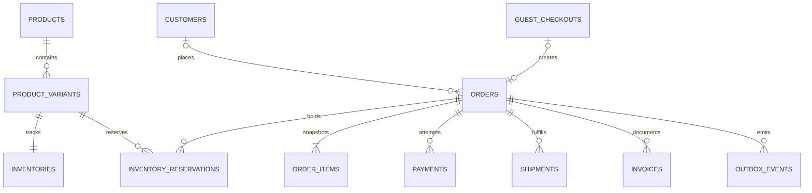

# 資料模型草案

日期：2026-11-13｜狀態：供原型與正式版設計討論，尚未核准為 production schema 或 Migration。

原型目前只使用瀏覽器假資料。以下表格與交易規則是正式版候選設計，不能作為「正式庫存、會員與支付已完成」的證據。

## 原型實際資料形狀

原型目前由 `src/catalog.ts` 與 `src/model.ts` 定義，與下方正式關聯式模型分開：

- `CartLine` 只存 `variantId`、`quantity`；`CartSummary` 解析當前商品與 SKU，提供金額、可購量、問題訊息、是否可結帳、是否混單與最長示意備貨天數。
- `MockOrder` 保存商品名稱／圖／顏色／尺寸／單價／行金額／備貨日數快照，以及訂單金額、一次運費、聯絡與門市示意資料、混單訊息、`simulated: true`。
- 訂單狀態為 `preparing`／`shipped`／`completed`／`cancelled`；付款狀態為 `simulated_paid`／`cod_pending`／`simulated_refunded`／`cancelled`。帶有 simulated 的狀態只表示假流程，並未呼叫金流退款。
- SKU 的 `stock` 在原型代表有限可購額度：現貨可售數量或預購示範配額。模擬下單先檢查所有品項，再複製資料一次扣除；沒有另建正式保留表。
- 只有 `preparing` 訂單允許取消並回補原 SKU 一次；`stockRestored`／已取消狀態防止再次回補，已出貨或完成的訂單拒絕取消。COD 保持 `cod_pending`，不因尚未收款自動取消。

以上是單一呼叫端的純函式與瀏覽器資料示範，不提供跨分頁鎖、多人交易、可信伺服器金額或安全訂單查詢。

## 1. 主要關係

商品（款式）、SKU、實體庫存、預購可承接量、訂單與支付各有自己的語意。訂單不能只靠單一「已完成」欄位表示付款、物流及發票狀態。

## 2. 候選資料表

主鍵與時間／稽核欄位依最終 XK 專案規範定案；下表只列領域上的重要欄位。

| 表 | 重要欄位／責任 |
| --- | --- |
| `products` | `id`、`slug`、名稱、分類、描述、材質、上下架狀態；產品圖另以圖片儲存 key／排序記錄 |
| `product_variants` | `id`、`product_id`、唯一 `sku`、顏色、尺寸、價格、`supply_type`（STOCK／PREORDER）、備貨資訊、啟售狀態 |
| `inventories` | 每 SKU 一筆；`on_hand`、`reserved_stock`、`preorder_capacity`、`reserved_preorder`、`version`。現貨與預購額度不可互相冒用 |
| `inventory_reservations` | `id`、`order_id`、`variant_id`、來源（現貨／預購）、數量、狀態、`expires_at`、提交／釋放原因；保存原子保留與釋放的依據 |
| `customers` | 註冊會員資料、認證身分或密碼雜湊引用、聯絡方式、啟用狀態；正式認證策略另審，不存明文密碼 |
| `guest_checkouts` | 單次訪客結帳識別、逾期時間及查單權杖雜湊等候選欄位；訪客不自動變成永久會員，也不只憑相同 email 合併身分 |
| `orders` | 訂單編號、會員或訪客關聯、訂單／支付／履約狀態、金額、一次運費、聯絡與配送快照、混單政策快照、整單出貨資訊 |
| `order_items` | 商品／SKU 關聯及名稱、顏色、尺寸、單價、數量、現貨／預購、備貨日數與預計出貨資訊快照；不能隨商品後改價而變動 |
| `payments` | 每次付款嘗試、供應商、商家交易編號、供應商交易編號、金額、狀態、通知／查詢時間；退款另有紀錄或子表 |
| `shipments` | 配送方式、超商／門市代碼、物流單號、物流及 COD 代收／撥款狀態、寄出／取貨／退回時間；物流與支付分別核實 |
| `invoices` | 發票服務、開立編號、金額／稅別、開立／作廢／折讓狀態與回應紀錄；不因前端付款成功頁就直接開票 |
| `idempotency_records` | 操作範圍、冪等 key、請求雜湊、處理狀態與結果引用；同 key 不同內容應拒絕，通知識別依服務商實際契約定案 |
| `outbox_events` | 與訂單／支付交易一起寫入的待送事件、唯一事件識別、重試次數、下一重試時間、完成時間與錯誤摘要；供通知／發票等外部工作使用 |

商品圖片可另設 `product_images`，庫存異動、退款與稽核可另設明細表；是否採用須在正式建模時確認，這不是已執行的建表腳本。

## 3. 金額與快照

- 原型價格採整數新台幣元，正式版須先固定金額單位、稅額與折扣分攤策略，避免 JavaScript 浮點運算造成差異。
- 前端傳入的總價、運費或供貨狀態不作為最終依據；正式下單由伺服器重算並保存快照。
- 商品上下架、改名、改價或後續修改備貨天數，不回寫既有訂單快照。
- 混單依本案已確認政策整單出貨，整單資訊必須能顯示最晚待備貨的品項；示意備貨日數不等於供應商正式承諾。

## 4. 現貨與預購保留

候選計算：現貨可售量為 `on_hand - reserved_stock`；預購可承接量為 `preorder_capacity - reserved_preorder`。預購額度未核定時，不預設無限額。

正式下單應在單一資料庫交易中，按固定 SKU 順序鎖定或以版本／條件更新檢查可購量，再建立訂單、品項、保留紀錄及必要 outbox 事件。所有數量不得小於零。正式併發測試須驗證最後一件同時下單只允許一張成功。

建議的保留生命週期：

| 情境 | 候選處理 |
| --- | --- |
| 線上付款訂單建立 | 保留現貨／預購額度；付款期限可設定，不能在本草案逕定商業期限 |
| 支付完成 | 核對有效通知／查詢與金額後提交保留；同通知重送不重複提交 |
| 線上付款逾時 | 在可證實未付款且符合政策時釋放保留；晚到的成功通知走重新取得庫存或退款／人工處理，不可造成負庫存 |
| 超商取貨付款 | 訂單確認後持續占用；不能套用線上付款短期未付款逾時，因為它是先出貨、領取時收款 |
| 出貨 | 現貨實體扣減與已保留量消耗在交易中完成；預購到貨與入庫／分配需有可追溯紀錄 |
| 出貨前取消 | 按政策釋放尚未消耗的保留一次；已付款款項另追蹤退款結果 |
| 未取退回或退貨 | 追蹤退回與驗收；收到並確認可再販售後才回補可售庫存，不以一筆物流退件通知直接視為可售 |

正式 SQL、交易隔離與可重試錯誤規則在後端實作前審查；原型的本機函式不提供多人併發或金流一致性保證。

## 5. 狀態、回調與外部工作

- 訂單、支付、物流、退款及發票各自保留狀態與合法轉移，不將「已到店」當成「已付款」，也不將「已退款申請」當成「已退款」。
- 支付回調先依供應商規格驗證簽章、商家、訂單、幣別與金額，保存可稽核結果，再進行可冪等的狀態轉移。
- 通知可能重送、延遲或漏送，需有查詢／對帳補償；不能只看瀏覽器返回成功頁。
- 冪等 key 的來源依真實 API 定案，不假設每家供應商一定有 `event_id`；重複通知不重複扣庫存、開票、寄信或建立物流單。
- 外部 API 呼叫放在可追蹤重試／補償流程；outbox 與本地領域交易一致寫入，避免「資料已改但外部工作遺失」。

## 6. 資料存放與責任

原碼、文件與測試放產品儲存庫；正式商品／會員／訂單放資料庫，照片放具存取控制與備份策略的物件儲存。憑證由安全設定注入，不寫入 Git 或前端 bundle。

朋友店家持有營運主體與服務帳戶；XK System 處理受授權的技術設定。個資保存期限、員工權限、備份還原及營運稽核仍須定案。正式登入／資料隔離／金流／物流／發票與併發測試另作驗收。
